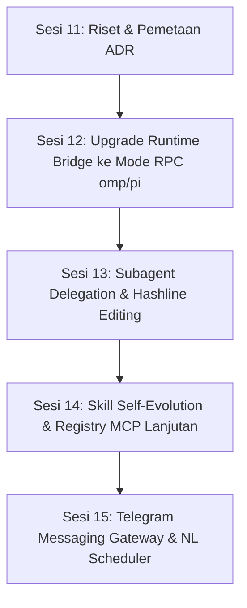

# ADR 0004: Pemetaan Fitur Runtime Eksternal (omp, Hermes, pi.dev, Odysseus) & Strategi Integrasi Personal AI OS

**Status**: Diusulkan (Proposed)  
**Tanggal**: 15 Oktober 2026 (Sesi 11)  
**Pengambil Keputusan**: Principal Software Architect & DevOps Engineer  
**Konteks**: Sesi 11 — Riset dan ADR Pemetaan Fitur (Tanpa Kode Produk)  
*Catatan Penomoran: Dinamai sesuai penugasan `0004-pemetaan-fitur-runtime.md` (mengikuti urutan keputusan arsitektur #0013).*

---

## 1. Konteks & Masalah

*Personal AI OS* saat ini memiliki execution plane ganda:
1. **Worker Internal (`apps/agent-worker`)**: Loop otonom berbasis TypeScript yang terintegrasi dengan gateway model 9Router, Permission Engine, BullMQ, dan Tool Registry lokal/MCP.
2. **Runtime Bridge Host (`apps/runtime-bridge`)**: Daemon HTTP loopback (port 9120) terisolasi yang saat ini memanggil binary host CLI secara sekali jalan (*one-shot*):
   - `omp -p <prompt> --mode json --no-session`
   - `hermes -z <prompt> --no-restore-cwd --safe-mode`

Meskipun `omp` (v18.6.1) dan `hermes` (v0.20.5) telah terverifikasi terpasang di host VPS Oracle Cloud ARM64 (`servernic`), penggunaannya masih sangat terbatas sebagai eksekutor skrip CLI sekali jalan. Sementara itu, ekosistem agent open-source (seperti `omp.sh`, Nous Research `Hermes Agent`, `pi.dev`, dan `Odysseus`) telah mengembangkan kapabilitas mutakhir seperti:
- Mode RPC interaktif dua arah (streaming event dan injeksi tools)
- Sesi persisten dan percabangan riwayat (*tree branching*)
- Subagent paralel terisolasi
- Integrasi LSP (Language Server Protocol) dan hashline file editing
- Pembuatan skill mandiri (*self-evolving skills*)
- Gateway perpesanan lintas platform (Telegram, Discord, Slack, WhatsApp, Signal, Email)
- Penjadwalan tugas bahasa alami (*natural language cron*)

Tantangan utama proyek:
- **Batasan Sumber Daya VPS**: Oracle Cloud ARM64 dengan 2 OCPU dan 11 GiB RAM (tanpa swap space aktif).
- **Aturan Proyek Keras**: *"Tanpa inferensi LLM lokal di VPS."* Semua pemanggilan model wajib melalui backend gateway 9Router.
- **Kedaulatan & Keamanan Pengguna**: Tindakan berisiko tinggi wajib melewati *Permission Engine*; dilarang ada penyimpanan memori diam-diam (*zero silent storage*).

ADR ini memetakan seluruh kapabilitas dari 4 runtime eksternal tersebut terhadap arsitektur *Personal AI OS* dan menetapkan keputusan: **Integrasikan lewat bridge/MCP/skill**, **Implementasikan native di repo**, atau **Lewati (Skip)**.

---

## 2. Inventaris Sumber & Status Verifikasi Empiris

Setiap klaim dalam dokumen ini didasarkan pada dokumentasi resmi dan verifikasi host nyata:

| Runtime | Sumber Resmi (URL) | Versi Terdokumentasi | Tanggal Akses | Status di VPS Oracle (`servernic`) | Lisensi | Kebutuhan Memori (RSS) di ARM64 |
|---|---|---|---|---|---|---|
| **omp** | [omp.sh](https://omp.sh/)<br>[github.com/oh-my-pi/pi-coding-agent](https://github.com/oh-my-pi/pi-coding-agent) | `18.6.1` (Host)<br>`18.6.1` (Upstream) | 15 Okt 2026 (Web)<br>11 Okt 2026 (Host) | **TERPASANG** (`/home/ubuntu/.local/bin/omp`) | MIT | **~388 MB** (uji live probe VPS, max ~403 MB) |
| **Hermes** | [hermes-agent.nousresearch.com](https://hermes-agent.nousresearch.com/)<br>[github.com/NousResearch/hermes-agent](https://github.com/NousResearch/hermes-agent) | `0.20.5` (2026.8.19) | 15 Okt 2026 (Web)<br>11 Okt 2026 (Host) | **TERPASANG & AKTIF** (`/home/ubuntu/.local/bin/hermes`, Daemon PID 613535 di `0.0.0.0:9119`) | MIT | **~160 MB** (CLI probe VPS, Python 3.11.15) |
| **pi.dev** | [pi.dev](https://pi.dev/)<br>[github.com/earendil-works/pi](https://github.com/earendil-works/pi) | `1.0` (dengan Pi Durable) | 15 Okt 2026 (Web) | **TIDAK TERPASANG DI VPS** (`which pi` kosong; ada di workstation lokal v1.1.0) | MIT | **~150–250 MB** (estimasi Node.js runtime) |
| **Odysseus** | [odysseus-dev.github.io/odysseus](https://odysseus-dev.github.io/odysseus/)<br>[github.com/odysseus-dev/odysseus](https://github.com/odysseus-dev/odysseus) | `0.1.x` (Latest release) | 15 Okt 2026 (Web) | **TIDAK TERPASANG DI VPS** (tanpa referensi di repo) | MIT | **~200–400 MB** (Web/Node footprint, *tanpa local model*) |
| **Personal AI OS** | Repo Lokal (`pnpm workspace`) | `0.2.0` | 15 Okt 2026 | **BERJALAN** (Docker Compose + Tauri + Expo) | Proprietary / MIT | **~1.8–2.2 GB** (Postgres + Redis + API + Worker + Caddy) |

*Catatan Verifikasi*: Endpoint HTTP daemon Hermes di port 9119 terbukti aktif, namun rute OpenAPI 3.1.0 yang diprobe pada 2026-10-11 tidak mengekspos endpoint pengiriman prompt teks yang terotentikasi. Status HTTP prompt execution diberi label **TIDAK TERVERIFIKASI**.

---

## 3. Matriks Fitur Lengkap

Keputusan:
- **`Native`**: Dibangun langsung di dalam TypeScript codebase kita (`apps/api`, `apps/agent-worker`, `packages/*`, Windows/Android UI).
- **`Bridge`**: Didelegasikan ke binary host melalui `apps/runtime-bridge` atau adapter proses.
- **`MCP/Skill`**: Dibungkus sebagai Model Context Protocol tool atau file skill on-demand.
- **`Lewati`**: Tidak diadopsi karena melanggar batasan arsitektur (misal inferensi lokal VPS) atau redundan.

| Kategori Fitur | omp (18.6.1) | Hermes (0.20.5) | pi.dev (1.0) | Odysseus | Personal AI OS Saat Ini | Keputusan Kita | Usaha (S/M/L) | Risiko Keamanan | Dampak UX |
|---|---|---|---|---|---|---|---|---|---|
| **1. Mode RPC Dua Arah** | NDJSON via stdin/stdout (`--mode rpc`) | Python RPC script & subagents | JSONL via stdin/stdout (`docs/rpc.md`) | Tidak ada (Web API only) | One-shot CLI spawn (`node:child_process`) | **Bridge** (Adopsi protokol NDJSON omp/pi pada runtime-bridge) | **M** | Rendah (stdin/stdout pipe terisolasi) | **Tinggi** (Streaming realtime token, interupsi instan) |
| **2. Sesi Persisten & Resume** | Built-in session store | `--resume <session>` / SQLite FTS5 | Tree session (`/tree`, branch any turn) | Local session history | DB Postgres (`conversations`, `messages`, BullMQ checkpoints) | **Native** (Pertahankan Postgres + Checkpoint Drizzle) | **S** | Rendah (Sudah di-sandbox) | **Tinggi** (Konsistensi data antar platform) |
| **3. Subagent Paralel** | Roles: scout, reviewer, librarian | `delegate_task` (max 10 concurrent, flat/orchestrator) | Extension sub-agent example | Background agents | Generic track single-worker | **Native + Bridge** (Worker spawn subagent via BullMQ / omp role) | **M** | Sedang (Wajib kuota & batasan kedalaman spawn) | **Tinggi** (Penyelesaian tugas kompleks tanpa blocking) |
| **4. Edit File Presisi** | Hashline edits (line-anchored hash) | Python workspace tools | Line diff / Patch tool | File edit tools | `multi_replace_file_content` & `replace_file_content` | **Native + Skill** (Standarisasi hashline edit pattern) | **S** | Rendah (Validasi path traversal tetap aktif) | **Tinggi** (Hemat token drastis, anti-hallucination diff) |
| **5. LSP & Diagnostik** | In-process LSP (`dlv`, `debugpy`, `lldb-dap`) | External linters via bash | TypeScript extension hooks | Tidak ada | Evaluator checks (lint, typecheck, build) | **Bridge (ke omp)** | **M** | Sedang (Akses filesystem repo host) | **Tinggi** (Deteksi syntax/type error sebelum commit) |
| **6. Memori Jangka Panjang** | Project rules & system prompt | `MEMORY.md`, `USER.md`, SQLite FTS5 | Context compaction, extensions | Semantic recall | PostgreSQL tsvector hybrid search + proposals queue | **Native** (Pertahankan Drizzle Memory Sesi 10) | **S** (Selesai) | Sangat Rendah (Zero silent storage) | **Tinggi** (Kedaulatan pengguna & kontrol persetujuan) |
| **7. Self-Evolving Skills** | Skill directory loader | Autonomous skill creation | On-demand skill folders | Tool self-writing | `packages/tools` registry statis + custom skills | **Skill / Native** (Pola Hermes: simpan skill baru sebagai proposal) | **M** | Tinggi (Eksekusi kode asing wajib approval) | **Tinggi** (Agen semakin pintar seiring pemakaian) |
| **8. Penjadwalan Alami** | Flag `--max-time` CLI | Natural language cron scheduler | Scheduled prompts extension | Cron jobs | BullMQ scheduler engine (`apps/scheduler`) | **Native** (Parser NL ke cron format di API/Scheduler) | **S** | Rendah (BullMQ sudah jalan) | **Tinggi** (Pengguna bisa minta: "Ingatkan saya besok pagi") |
| **9. Gateway Perpesanan** | Tidak ada (CLI only) | Telegram, Discord, Slack, WhatsApp, Signal, Email | Tidak ada (Terminal TUI) | Email IMAP/SMTP | Push notification FCM + WebSocket client | **Integrasikan (Hermes Gateway / Bot Native)** | **M** | Sedang (Token bot & otentikasi user ID) | **Sangat Tinggi** (Akses asisten dari mana saja tanpa buka app) |
| **10. Ekstensi / Plugin** | Rust core + TS extensions | Python plugin system | TypeScript package ecosystem | Custom MCP tools | Stdio MCP Server Adapter (`packages/mcp`) | **MCP / Skill** (Standarisasi pada MCP & Antigravity Skills) | **S** | Rendah (Guarded by Permission Engine) | **Tinggi** (Ekosistem alat yang modular dan aman) |
| **11. Local Model Serving** | Tidak ada | Tidak ada | Tidak ada | Built-in cookbook 270+ local models | Tidak ada (9Router gateway saja) | **Lewati (Skip)** | **N/A** | Kritis (Pelanggaran aturan VPS & OOM) | Netral (Model cloud gateway lebih hemat daya) |
| **12. Side-by-Side Model Compare** | Tidak ada | Tidak ada | Multi-model switcher (`Ctrl+L`) | Multi-model compare matrix | Single model routing + fallback | **Lewati (Tahap Awal)** | **S** | Rendah | Rendah (Fokus asisten tunggal handal) |

---

## 4. Pembahasan Mendalam 9 Kandidat Wajib

### 4.1 Sesi Persisten dan Resume
- **Kondisi Saat Ini**:
  - `apps/runtime-bridge` mengeksekusi runtime dengan `--no-session` (disposable per task).
  - Backend `apps/api` menyimpan percakapan di tabel `conversations` dan `messages` PostgreSQL, sementara task menyimpan checkpoint di `tasks.checkpoint`.
- **Analisis & Komparasi**:
  - `pi.dev` menggunakan struktur sesi pohon (*tree-structured history*), memungkinkan percabangan percakapan dari sembarang titik.
  - `Hermes` menyimpan sesi di SQLite lokal dengan FTS5 dan dapat di-resume melalui `hermes --resume <id>`.
  - `omp` menyimpan riwayat sesi di `~/.omp/agent/sessions/`.
- **Keputusan: IMPLEMENTASIKAN NATIVE DI POSTGRESQL**.
  - Mengandalkan penyimpanan sesi di level runtime host (`omp`/`Hermes`) menimbulkan risiko *split-brain* antara basis data kontrol PostgreSQL dengan disk host VPS.
  - Strategi kita: Database PostgreSQL tetap menjadi *single source of truth*. Riwayat konteks di-replay ke runtime bridge sesuai anggaran token menggunakan `ContextManager`.

### 4.2 Subagent Paralel (Task Delegation)
- **Kondisi Saat Ini**:
  - `TaskExecutor` di `apps/agent-worker` mengeksekusi task secara sekuensial dalam satu proses.
- **Analisis & Komparasi**:
  - `Hermes Agent` memiliki sistem `delegate_task` terbaik: subagent diisolasi dalam thread/proses baru, memiliki terminal sendiri, dan **tidak mewarisi memori personal (`MEMORY.md`)** agar konteks tidak tercemar (`skip_memory=True`). Batas default 10 subagent konkuren dengan kontrol `role="orchestrator"` vs daun (`leaf`).
  - `omp` memiliki peran subagent terdefinisi (`scout`, `reviewer`, `librarian`).
- **Keputusan: NATIVE (VIA BULLMQ) DENGAN PATTERN HERMES**.
  - Worker utama dapat memecah task besar menjadi child-tasks yang dienqueue ke antrean BullMQ `personal-ai-os-tasks` dengan referensi `parent_task_id`.
  - Setiap subagent berjalan di container worker terpisah dengan memori bersih (*clean context*), dibatasi kedalaman delegasi maksimum 1 (`max_spawn_depth = 1`) untuk mencegah rekursi tak terbatas.

### 4.3 Edit File yang Presisi (Hashline Edits vs Full Diff)
- **Kondisi Saat Ini**:
  - Kita menggunakan `replace_file_content` dan `multi_replace_file_content` berbasis pencocokan substring unik (`TargetContent` -> `ReplacementContent`).
- **Analisis & Komparasi**:
  - `omp` mengimplementasikan **Hashline Edits**: baris target diidentifikasi dengan nomor baris + hash pendek konten baris tersebut (contoh: `12#a1b: target code`). Hal ini menghemat token model hingga 70% dibandingkan mengirimkan diff lengkap atau rewriting file, sekaligus menghindari kesalahan salah timpa jika file telah berubah (*optimistic concurrency check*).
  - `pi.dev` menggunakan slice editing presisi dengan fallback linter.
- **Keputusan: NATIVE DI PACKAGES/TOOLS + SKILL PROMPT**.
  - Mengadopsi format hashline edit pada `packages/tools` untuk mengoptimalkan kuota token 9Router dan meningkatkan akurasi koding otonom.

### 4.4 Integrasi LSP (Language Server Protocol) & Diagnostik
- **Kondisi Saat Ini**:
  - Evaluasi koding kita mengandalkan eksekusi CLI luar (`pnpm build`, `tsc --noEmit`, `eslint`) yang lambat karena harus memuat Node runtime berulang-ulang.
- **Analisis & Komparasi**:
  - `omp` memiliki klien LSP *in-process* yang terhubung ke language server (`typescript-language-server`, `gopls`, `pyright`). Model dapat menanyakan diagnostik kesalahan tipe, definisi simbol (*jump to definition*), dan referensi sebelum mencoba menjalankan build.
- **Keputusan: INTEGRASIKAN LEWAT OMP DI RUNTIME-BRIDGE**.
  - Untuk tugas koding kompleks di VPS, worker dapat mendelegasikan pemeriksaan diagnostik cepat ke `omp` via bridge daripada menjalankan full build pipeline yang boros CPU.

### 4.5 Memori dan Skill yang Belajar Sendiri (Self-Evolving Skills)
- **Kondisi Saat Ini**:
  - Sesi 10 telah menyelesaikan sistem Memori: filter data sensitif, pencarian teks PostgreSQL hybrid, dan antrean usulan (*proposals queue*).
  - Skill masih bersifat file statis di `packages/tools` dan `skills/`.
- **Analisis & Komparasi**:
  - `Hermes Agent` dan `Odysseus` memiliki fitur di mana agen dapat mendeteksi alur kerja berulang, menulis skrip/instruksi skill baru, dan menyimpannya ke direktori skill lokal.
- **Keputusan: NATIVE SKILL GENERATOR DENGAN PERMISSION GATE**.
  - Mengadopsi konsep Hermes: saat agen menemukan solusi unik, agen membuat draf skill (`SKILL.md`).
  - **Aturan Keamanan Ketat**: Sesuai prinsip *zero silent storage*, skill baru **wajib masuk antrean usulan (proposal)** dan membutuhkan persetujuan eksplisit pengguna sebelum diaktifkan ke registry runtime.

### 4.6 Penjadwalan Bahasa Alami (Natural Language Cron)
- **Kondisi Saat Ini**:
  - `apps/scheduler` memiliki engine BullMQ yang mampu menjalankan cron ekspresi 5-field (`*/5 * * * *`).
  - Pengguna di chat belum memiliki antarmuka bahasa alami untuk membuat jadwal otomatis.
- **Analisis & Komparasi**:
  - `Hermes` memungkinkan perintah: *"Setiap jam 8 pagi, rangkum berita AI di Hacker News dan kirim ke Telegram."* Hermes mem-parse kalimat ini menjadi cron job internal.
- **Keputusan: NATIVE DI APPS/API (TOOL & CHAT ROUTE)**.
  - Menambahkan tool `schedule_task` ke registry agent. Model gateway 9Router mem-parse intensi waktu pengguna menjadi ekspresi cron baku, lalu menyimpannya ke tabel `schedules` PostgreSQL.

### 4.7 Gateway Pesan Eksternal (Telegram, Discord, WhatsApp, Email)
- **Kondisi Saat Ini**:
  - Klien pengguna terbatas pada aplikasi desktop Windows (Tauri) dan mobile Android (Expo). Jika pengguna sedang bepergian tanpa membuka aplikasi, asisten tidak dapat diakses.
- **Analisis & Komparasi**:
  - `Hermes Agent` memiliki modul gateway perpesanan terintegrasi untuk Telegram bot, Discord, Slack, WhatsApp, Signal, dan Email.
  - Ini memungkinkan pengguna berinteraksi dengan asisten yang sama, memori yang sama, dan menerima notifikasi task/approval langsung di Telegram.
- **Keputusan: INTEGRASIKAN GATEWAY TELEGRAM & DISCORD SECARA NATIVE**.
  - Menambahkan service gateway perpesanan ringan di backend (dimulai dari Telegram Bot API via webhook Fastify).
  - Otentikasi: Mengaitkan `telegram_chat_id` dengan `users.id` di PostgreSQL melalui token pairing sekali pakai.
  - Seluruh pesan dari Telegram diteruskan ke pipeline Agent Core yang sama. Notifikasi persetujuan (*Approval*) dikirim dengan tombol inline (*Approve / Deny*).

### 4.8 Ekstensi / Plugin (Ecosystem Compatibility)
- **Kondisi Saat Ini**:
  - Repo kita telah mengimplementasikan adapter MCP stdio (`packages/mcp`) yang aman di balik `SecuredCapabilityGuard`.
- **Analisis & Komparasi**:
  - `pi.dev` mendukung package ekstensi TypeScript pihak ketiga (`pi install npm:@foo/bar`).
  - `Odysseus` dan `Hermes` mendukung MCP dan file skrip Python.
- **Keputusan: STANDARISASI PADA MCP (MODEL CONTEXT PROTOCOL)**.
  - Kita menolak instalasi paket dinamis yang tidak diaudit ke dalam host runtime. MCP menyediakan batas isolasi proses (*process boundary*) terbaik dan sudah didukung penuh oleh arsitektur izin kita.

### 4.9 Mode RPC Runtime (Streaming Dua Arah)
- **Kondisi Saat Ini**:
  - `apps/runtime-bridge` menjalankan proses anak via `spawn(..., { stdio: ['ignore', 'pipe', 'pipe'] })`. Output dikumpulkan dalam buffer hingga selesai, lalu dikembalikan via HTTP 202/SSE.
- **Analisis & Komparasi**:
  - Baik `omp` maupun `pi.dev` memiliki protokol RPC berbasis baris JSON (JSONL / NDJSON) melalui stdin/stdout yang matang.
  - Protokol ini mendukung:
    1. Pengiriman prompt tanpa respawn proses (`{"id":"1", "type":"prompt", "message":"..."}`)
    2. Streaming event langsung per-token (`turn_start`, `message_update`, `turn_end`)
    3. Injeksi tool host (`set_host_tools`): model di dalam `omp` dapat memanggil tool yang dieksekusi oleh backend kita!
- **Keputusan: IMPLEMENTASIKAN NDJSON RPC CLIENT DI RUNTIME-BRIDGE**.
  - Meng-upgrade `apps/runtime-bridge` dari mode one-shot CLI menjadi long-lived persistent process pool yang berkomunikasi melalui NDJSON stdio.

---

## 5. Rencana Urutan Implementasi & Pecahan Sesi Lanjutan

Berdasarkan analisis nilai UX, kebutuhan arsitektur, dan tingkat kesulitan:



1. **Sesi 12 — Runtime Bridge RPC Engine**:
   - Upgrade `apps/runtime-bridge` untuk mendukung daemon worker jangka panjang (*long-lived process*) menggunakan protokol NDJSON `omp --mode rpc`.
   - Streaming event token secara realtime ke WebSocket API.
   - Pendaftaran host tools melalui `set_host_tools` agar runtime dapat memanfaatkan ToolRegistry dan Permission Guard kita.
2. **Sesi 13 — Task Delegation & Subagent Concurrency**:
   - Pola delegasi subagent terisolasi di `apps/agent-worker` via BullMQ child-tasks.
   - Implementasi hashline file editing pada `packages/tools` untuk efisiensi token.
3. **Sesi 14 — Skill Registry, Self-Evolution, & MCP Management**:
   - Layar antarmuka Skill & MCP di Windows dan Android (menggantikan placeholder Sesi 10).
   - Deteksi pola repetitif dan pengusulan skill otomatis ke antrean proposal.
4. **Sesi 15 — Gateway Perpesanan (Telegram Bot Integration) & Natural Language Scheduler**:
   - Endpoint webhook Telegram di `apps/api` untuk interaksi chat dua arah.
   - Kartu inline approval di Telegram untuk aksi tingkat HIGH/CRITICAL.
   - Parser bahasa alami ke cron job BullMQ.

---

## 6. Daftar Perintah Probe Read-Only (Diajukan untuk Persetujuan Pemilik)

Sesuai aturan kerja, **tidak ada perintah yang dijalankan di VPS produksi tanpa izin eksplisit**. Jika pemilik menghendaki verifikasi empiris mendalam terhadap mode RPC dan daemon port 9119 di host VPS, berikut daftar perintah *read-only* aman yang diusulkan untuk disetujui:

```bash
# Probe 1: Periksa handshake dan output bantuan mode RPC omp (tanpa memanggil LLM/kredit)
/home/ubuntu/.local/bin/omp --mode rpc --help

# Probe 2: Uji startup frame ready protokol RPC omp via stdin kosong
echo '{"type":"ping"}' | timeout 3 /home/ubuntu/.local/bin/omp --mode rpc --no-session

# Probe 3: Inspeksi command line proses port 8000 dan 9119 untuk verifikasi kaitan Hermes
cat /proc/613535/cmdline | tr '\0' ' '; echo ""
cat /proc/940273/cmdline | tr '\0' ' '; echo ""

# Probe 4: Baca skema OpenAPI Hermes secara lokal (hanya rute yang terdaftar)
curl -s http://127.0.0.1:9119/openapi.json | grep -o '"/[^"]*"' | sort -u
```

---

## 7. Daftar 10 Pertanyaan Keputusan Strategis untuk Pemilik

Berikut adalah 10 keputusan strategis yang direkomendasikan untuk disepakati sebelum sesi implementasi berikutnya:

1. **Adopsi Mode RPC `omp`**:
   - *Pertanyaan*: Apakah Anda menyetujui `apps/runtime-bridge` ditingkatkan dari mode *CLI one-shot* menjadi *long-lived process* berbasis protokol NDJSON `omp --mode rpc`?
   - *Rekomendasi*: **Setuju**. Ini mengeliminasi latensi startup proses ~2 detik per eksekusi dan memungkinkan streaming token real-time ke aplikasi.
2. **Kredensial Gateway Embeddings di 9Router**:
   - *Pertanyaan*: Apakah Anda akan menambahkan API key embedding provider (misal OpenAI) ke 9Router, atau mempertahankan pencarian hybrid PostgreSQL full-text yang saat ini sudah stabil tanpa biaya?
   - *Rekomendasi*: **Pertahankan PostgreSQL Full-Text untuk sekarang**. Beralih ke vector embedding hanya jika pencarian teks terbukti kurang menangkap parafrase konsep.
3. **Integrasi Gateway Perpesanan (Telegram Bot)**:
   - *Pertanyaan*: Apakah Anda ingin asisten Personal AI OS dapat dihubungi melalui Telegram Bot (termasuk menerima notifikasi dan menyetujui approval via tombol inline)?
   - *Rekomendasi*: **Sangat Disarankan**. Ini memberikan nilai kepraktisan tertinggi bagi penggunaan harian saat berada jauh dari PC Windows.
4. **Subagent Concurrency Limit**:
   - *Pertanyaan*: Apakah batas konkurensi subagent paralel ditetapkan maksimum 3 task pada hardware 2 OCPU / 12 GB RAM ini?
   - *Rekomendasi*: **Setuju (Maksimal 3 subagent)**. Menghindari saturasi CPU dan menjaga headroom memori untuk PostgreSQL dan Redis.
5. **Kebijakan Pembuatan Skill Mandiri (Self-Evolving Skills)**:
   - *Pertanyaan*: Apakah skill baru yang diciptakan oleh AI wajib melalui antrean persetujuan pengguna (*proposal queue*) sebelum aktif?
   - *Rekomendasi*: **Wajib Lewat Persetujuan (Zero Silent Storage)**. Menjamin kode skrip skill baru tidak membahayakan sistem.
6. **Mekanisme Edit Kode (Hashline vs Substring Replace)**:
   - *Pertanyaan*: Apakah kita mengadopsi format hashline edit (`line#hash`) pada worker koding untuk menghemat token?
   - *Rekomendasi*: **Setuju**. Hemat token hingga ~70% dan mencegah bentrok pengeditan file (*merge collision*).
7. **Pemanfaatan LSP Host di Runtime Bridge**:
   - *Pertanyaan*: Apakah worker diizinkan meminta diagnostik LSP dari `omp` sebelum mengeksekusi build tugas koding?
   - *Rekomendasi*: **Setuju**. Mempercepat deteksi error koding tanpa harus menjalankan proses kompilasi penuh.
8. **Dukungan Hermes Daemon HTTP (Port 9119)**:
   - *Pertanyaan*: Apakah kita tetap mengabaikan port 9119 sampai ada endpoint prompt terotentikasi resmi dari Nous Research?
   - *Rekomendasi*: **Tetap Abaikan (Gunakan CLI/Bridge)**. Menghindari celah keamanan pada port unauthenticated.
9. **Penjadwal Bahasa Alami**:
   - *Pertanyaan*: Apakah model gateway 9Router diizinkan menerjemahkan instruksi pengguna di chat menjadi jadwal BullMQ otomatis?
   - *Rekomendasi*: **Setuju**. Setiap jadwal baru dicatat di tabel `schedules` dengan status aktif dan audit log.
10. **Pengabaian Odysseus Local Model Serving**:
    - *Pertanyaan*: Apakah Anda setuju fitur model serving lokal ala Odysseus dilewati sepenuhnya demi menjaga aturan *"Tanpa inferensi LLM lokal di VPS"*?
    - *Rekomendasi*: **Setuju (Lewati)**. Sumber daya VPS 12 GB dialokasikan penuh untuk performa data, queue, dan runtime tools.
