# Kebijakan Privasi & Tata Kelola Memori AI (Memory Privacy Policy)

**Personal AI OS — Dokumen Privasi & Tata Kelola Data**
*Status: Aktif*
*Terakhir Diperbarui: 15 Oktober 2026 (Sesi 10)*

---

## 1. Prinsip Utama Privasi Memori

1. **Kedaulatan Pengguna Penuh (User Sovereignty)**: Data memori adalah milik pengguna seutuhnya. Pengguna memiliki hak mutlak untuk melihat seluruh isi memori, menyunting, mencari, mengekspor, serta menghapus secara permanen kapan saja.
2. **Tidak Ada Penyimpanan Diam-diam (Zero Silent Storage)**: Agen AI dilarang keras menyimpan memori jangka panjang secara otomatis di latar belakang tanpa persetujuan eksplisit pengguna. Setiap ekstraksi kandidat memori dari percakapan atau task dieksekusi sebagai **USULAN (Proposal)** yang wajib ditinjau dan disetujui pengguna di antarmuka aplikasi.
3. **Penyaringan Data Sensitif Secara Proaktif (Sensitive Data Filter)**: Kredensial, token API, kunci privat, kata sandi, Nomor Induk Kependudukan (NIK), dan nomor kartu pembayaran dilarang disimpan ke dalam sistem memori. Sistem menerapkan deteksi dan redaksi pola regex sebelum data mencapai lapisan penyimpanan.
4. **Transparansi Mode Pencarian**: Pengguna selalu diinformasikan secara jujur mengenai mekanisme pencarian aktif (apakah pencarian semantik vektor atau pencarian teks PostgreSQL berbasis `tsvector`/`ILIKE`).

---

## 2. Lapisan Perlindungan Data Sensitif (SensitiveDataFilter)

Sebelum memori disimpan (baik melalui input langsung pengguna maupun usulan otomatis agen), data diproses melalui `SensitiveDataFilter`:

### 2.1 Pola yang Dideteksi dan Diredaksi/Ditolak
- **Kunci Rahasia & Token**: Kunci berawalan `sk-`, `ghp_`, `gho_`, `xoxb-`, `xoxp-`, `AKIA[0-9A-Z]{16}`, serta token JWT (`eyJ...`).
- **Kata Sandi**: Pola deklarasi kata sandi seperti `password = "..."`, `passwd: "..."`, `secret = "..."`.
- **Nomor Identitas Pribadi (NIK)**: Pola nomor identitas 16 digit Indonesia (`\b[1-9]\d{15}\b`), diredaksi menjadi `[REDACTED_IDENTITY_NUMBER]`.
- **Nomor Kartu Pembayaran**: Pola nomor kartu kredit/debit 13-19 digit dengan pemisah tanda hubung atau spasi, diredaksi menjadi `[REDACTED_CREDIT_CARD]`.

### 2.2 Penolakan Keras (Hard Rejection)
Jika input memori terdeteksi mengandung secret berisiko tinggi tanpa konteks yang dapat diredaksi secara aman, sistem melempar pengecualian `400 Bad Request` dengan pesan:
> *"Konten memori mengandung data sensitif atau kredensial rahasia yang dilarang disimpan."*

---

## 3. Siklus Hidup Ekstraksi & Persetujuan Memori (Proposal Workflow)

Untuk memastikan aturan **"Tidak ada penyimpanan diam-diam"**:

```mermaid
sequenceDiagram
    autonumber
    actor Pengguna
    participant Chat/Worker as Agent Worker / Chat
    participant Extractor as MemoryCandidateExtractor
    participant Filter as SensitiveDataFilter
    participant DB as PostgreSQL (memories table)
    participant UI as Windows / Android App

    Pengguna->>Chat/Worker: Selesaikan percakapan atau task
    Chat/Worker->>Extractor: Analisis konteks selesai
    Extractor->>Filter: Periksa fakta & preferensi kunci
    alt Mengandung Rahasia
        Filter-->>Extractor: Redaksi pola sensitif
    end
    Extractor->>DB: Simpan sebagai STATUS = 'proposed'
    DB-->>UI: Notifikasi / Badge Usulan Baru
    Pengguna->>UI: Buka Tab "Usulan Memori"
    alt Disetujui
        Pengguna->>UI: Klik "Setujui" (bisa diedit terlebih dahulu)
        UI->>DB: PATCH status = 'active'
    else Ditolak
        Pengguna->>UI: Klik "Tolak"
        UI->>DB: DELETE record proposal
    end
```

---

## 4. Kebijakan Retensi & Pembersihan Otomatis (Retention Sweeper)

Setiap catatan memori memiliki atribut `retention`:

| Nilai Retensi | Masa Berlaku (TTL) | Kasus Penggunaan Tipikal |
|---|---|---|
| `ephemeral` | 1 Hari (24 Jam) | Catatan konteks sementara untuk tugas jangka pendek |
| `session` | 7 Hari | Preferensi atau konteks berulang selama beberapa sesi |
| `30d` | 30 Hari | Catatan proyek atau sprint bulanan |
| `90d` | 90 Hari | Konteks kuartalan |
| `permanent` | Tak Terbatas | Fakta penting pengguna (disimpan sampai dihapus manual) |

### Mekanisme Sweeper:
- Sweeper dijalankan secara terjadwal atau melalui pemanggilan API administratif `POST /v1/memories/sweep`.
- Seluruh catatan berstatus selain `permanent` yang telah melewati `created_at + interval` akan dihapus dari basis data.
- Setiap operasi pembersihan menghasilkan catatan audit di tabel `audit_logs` dengan aksi `memory_sweep_expired` untuk akuntabilitas.

---

## 5. Cakupan Memori (Scope)

- **Global (`user`)**: Memori berlaku untuk seluruh percakapan dan agen milik pengguna (misal: preferensi bahasa, gaya komunikasi, editor favorit).
- **Proyek (`project`)**: Memori terikat pada `project_id` tertentu. Hanya dimuat oleh `ContextManager` saat agen bekerja dalam konteks proyek tersebut.

---

## 6. Hak Pengguna & Koreksi Data

1. **Hak Akses & Peninjauan**: Pengguna dapat melihat daftar seluruh memori aktif dan usulan di menu `Memori` (aplikasi Windows) atau `Pusat Memori` (aplikasi Android).
2. **Hak Koreksi (Edit)**: Pengguna dapat memperbaiki kalimat atau informasi memori yang keliru secara langsung.
3. **Hak Penghapusan (Hard Delete)**: Menekan tombol hapus akan langsung mengeksekusi penghapusan permanen dari PostgreSQL; data tidak diarsipkan secara tersembunyi.
